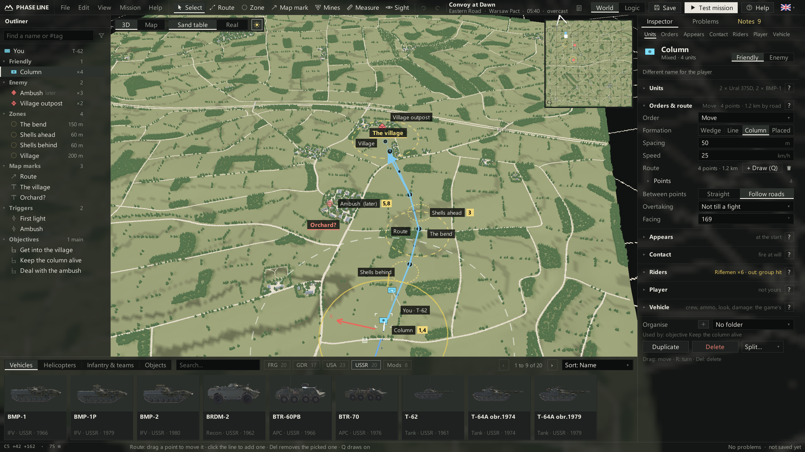
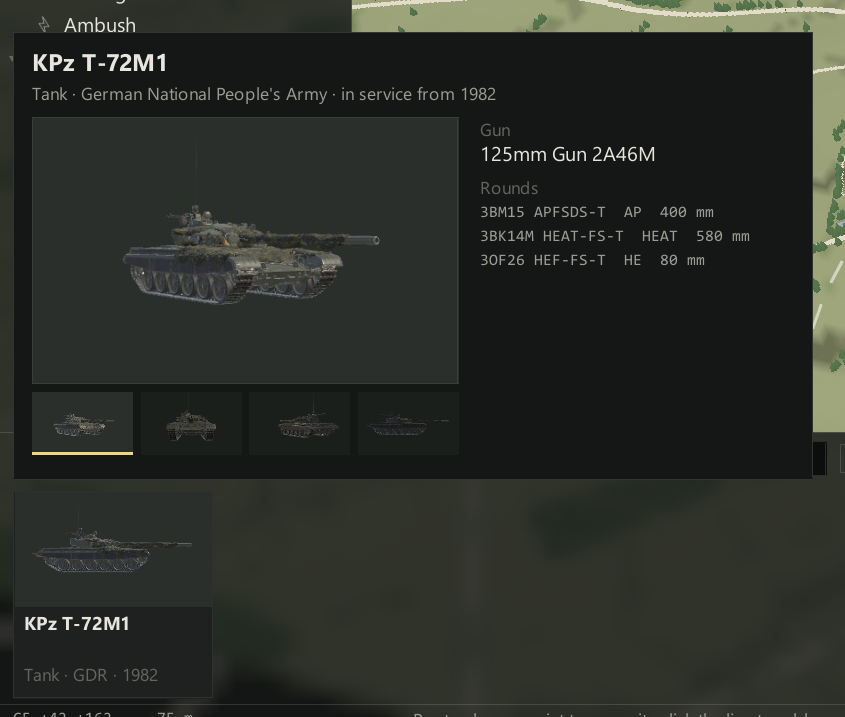
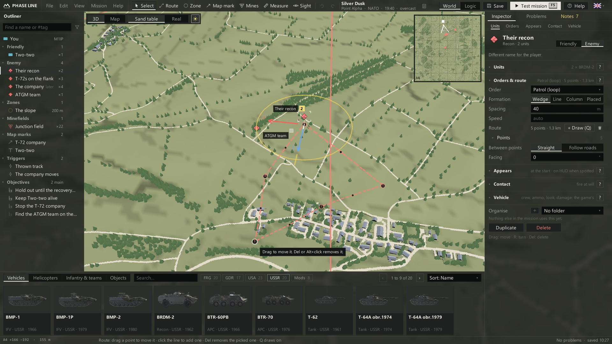
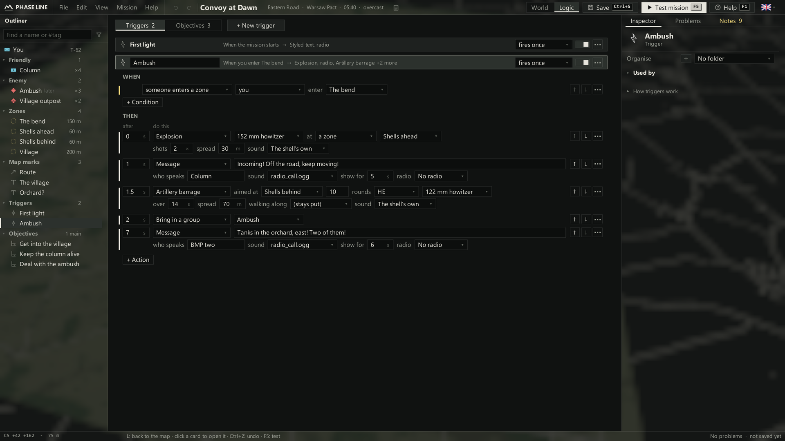
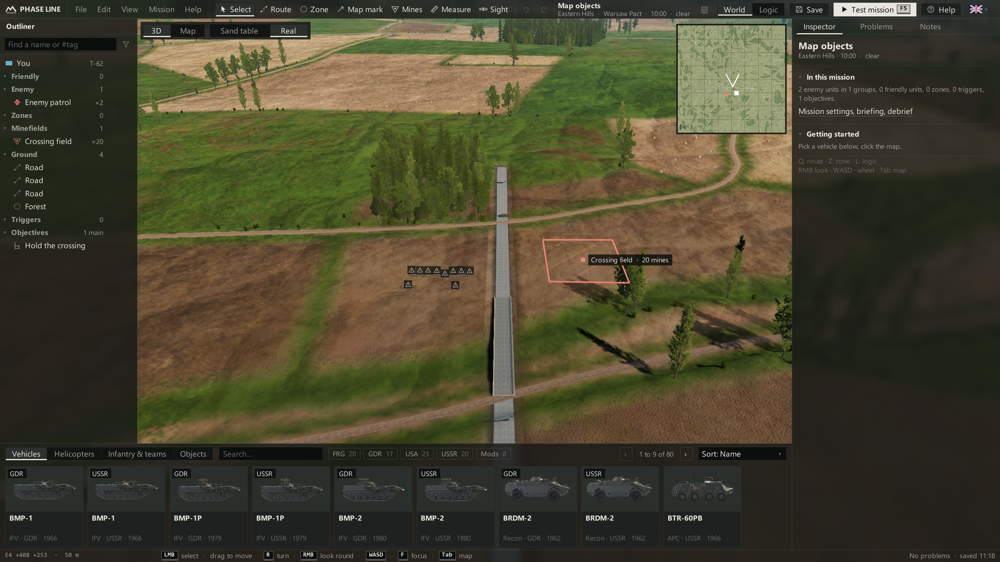
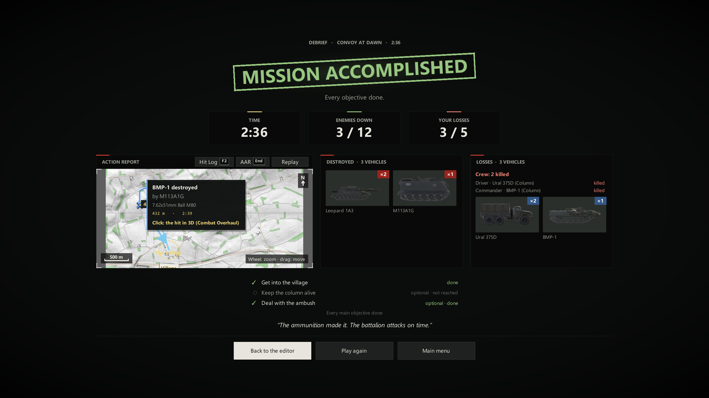

**English** · [Русский](README.ru.md) · [简体中文](README.zh-CN.md)

# Phase Line

**A mission editor for *Gunner, HEAT, PC!*, inside the game.**

Pick one of the game's maps, put units down, draw where they drive, write what happens and when, then press F5 and play it.

**[Download](../../releases/latest)** · [Install](#install) · [What's in it](#whats-in-it) · [Keys](#keys) · [FAQ](#faq-and-known-limits)

**[Join the unofficial GHPC modding Discord](https://discord.gg/BW2sgyCht7)**: updates, WIPs, other mod releases, and a place to chat with modders and the whole community.

---

GHPC's missions are great, but there are only so many, and after the tenth run you know where every T-72 sits. I wanted my own: a convoy that gets hit at a bend in the road, a hill that has to hold ten more minutes, a wingman who threw a track at the worst moment. Writing that by hand in a JSON file is no fun, so I built the editor into the game.

What you place is the real thing. The tanks in the editor are the game's own vehicles and the explosions are the game's own shells. F5 puts you in the tank, the key left of 1 brings you back to the editor where you left off.

## Install

**You need:** *Gunner, HEAT, PC!* build 20261014 and MelonLoader 0.7.x.

1. Install MelonLoader with the [MelonLoader installer](https://github.com/LavaGang/MelonLoader.Installer). Point it at `steamapps\common\Gunner HEAT PC\Bin\GHPC.exe` if it doesn't find the game.
2. Start the game once and close it.
3. Download `PhaseLine.dll` from [Releases](../../releases/latest) and put it in `Bin\Mods`.
4. Start the game. **Phase Line** is in the main menu.

It works on its own. With **Combat Overhaul** it moves into that mod's menu and uses its look. With **Task Force** you can play your missions in co-op.

First time? **Phase Line > Your first mission.** It builds a small mission with you, step by step, and ends with you playing it. About 15 minutes. F1 opens the handbook anywhere in the editor.

**Uninstall:** delete `Mods\PhaseLine.dll`. Your missions stay in `Bin\UserData\PhaseLine`.

## What's in it

### The editor

- **Every unit the game has.** Tanks, IFVs, trucks, helicopters, infantry, ATGM teams, with photos taken from your own game. Hover one for its gun, its rounds with penetration and the year it entered service. Vehicles from mods (Fulda Expansion Pack, Pact Increased Lethality) are in the list too.
- **Three views.** A sand table that's easy to read, the real game view, and a flat map with a grid.
- **An Outliner and an Inspector.** Folders, tags, find, hide and lock on the left. Everything about the thing you picked on the right, in sections that fold.
- **Undo with a history**, copy and paste between missions, templates.
- **A Problems list** that says what would break the mission before you test it.
- **Notes** you pin to groups, triggers and settings, for whoever opens your mission later.

### Groups and orders

- Hold, move, patrol, attack, hunt. Formations, spacing, speed.
- **Routes you can fix later.** Drag a waypoint, add one in the middle, delete one.
- **Variants and spare start spots**, rolled on every play, so the enemy isn't where it was last time.
- Crew skill, the exact rounds in the rack, your own custom round, paint and stowage.
- **Damage before the shooting starts.** Any part of any vehicle: a wingman with a thrown track, a T-72 with a dead thermal.
- **Infantry.** Squad presets or your own kit per man, riders in APCs who get out when you say (or when they're hit), groups up to 200 men.
- **Your platoon.** Wingmen who follow you, a choice of vehicles for the player, switching to another tank when yours burns.

### Convoys

Set a group to **Follow roads** and it drives like a column. You click the places that matter (the start, the junction, the bridge) and the mission fills in the road between them.

- They keep to the road, bends and all, and keep their gaps. The ones behind ease off when they bunch up, the lead slows down when the column is strung out.
- **Convoy drill** when they spot you: the vehicles already in the kill zone drive on through it, the rest stop short, pull off to both sides with guns to the threat, riders out.
- **Trucks in a fight:** the trucks can keep driving while the escort stays and fights.
- **Overtaking:** never, any time, or not till a fight.
- When a column backs off, it reverses along the road, not across the field.
- Roads you drew yourself count.

### Logic

- **Triggers that read like sentences.** "When the player enters the bend: shells on the road, a radio call, the ambush comes in." Time, zones, losses, objectives, other triggers, go codes.
- **Reinforcements** that are loaded with the map and hidden until a trigger brings them in, so nothing stutters.
- **Scripted fire.** Single explosions, barrages, smoke, flares, jets, or one round fired at the exact part of a tank you pick.
- **Sound and picture.** Radio calls, voice lines, music, pictures, typewriter text, title cards, camera shots, slow motion.
- **Objectives.** Destroy, reach, hold, protect, survive, recon ones, stop them reaching a place, hidden bonus ones.

### On the map

- Zones, map marks and NATO symbols the player sees on their map.
- Houses, walls, trenches and fire positions.
- Minefields you draw, with signs if they're yours.
- Roads, bridges, forests and clearings.

### Zeus

Press **\\** in a running mission and you're over the battle in a free camera. Pick units, right-click where they go or who they hit, spawn a platoon behind the ridge, drop HE, smoke, mines or an IED, pause, jump into any tank. Points to spend if you want it fair. When the battle gets good, save it as a new mission.

In a test run, **Edit mission** puts the editor's panels over the fight. What you change is saved and happens right away.

Players only get Zeus if the mission says so. By default it's yours, in test runs.

### Briefing, debrief, action report

- A briefing with your words, pictures and music, and an operations map with your arrows and objective areas.
- A real date with the real sun and moon, the weather and fog.
- Fire support for the player on the game's own map screen: artillery, smoke, flares, and air strikes on maps that have jets.
- After the mission: how it went, then an action report with where everyone drove and who got whom.

### Campaigns

Missions in a row, with branches for won and lost. Four kinds: a plain chain, losses that stick, a crew with names who get better (or get replaced), or a whole company you repair and refill between missions.

### Sharing

**Share** packs any number of missions into one `.ghpack` file with their pictures and sounds. Whoever imports it is told which mods it needs and can pick a stand-in for any vehicle they don't have.

Switch on **Locked: play only** and people can play your mission but not open it in the editor.

### Sample missions

Play them, or open a copy and take it apart. Each has notes on how it's built.

| | |
|---|---|
| **Convoy at Dawn** | Lead a supply column down the Eastern Road. Someone has been watching that road all night. |
| **Human Wave** | Four M113s on a hill. Two hundred men coming up the slope. |
| **Silver Dusk** | Your wingman threw a track at Point Alpha. The recovery vehicle is ten minutes out. |

And a sample campaign, **Three Days on the Border**.

### Learning it

- **A look round:** one short card per part of the editor.
- **Your first mission** and **A bigger mission:** guides that build a mission with you and wait for each step.
- Short guides for the Browser, the Inspector, Logic, Mission settings, minefields and testing.
- **The handbook** on F1, with a page for every part. English, Russian and Chinese.
- The editor itself is in English, Polish, German, Russian and Chinese.

## Keys

In the editor:

| Key | |
|---|---|
| F1 | Handbook |
| F2 | Mission settings |
| F5 | Test the mission |
| Tab | Flat map / 3D |
| T | Sand table / real view |
| L | Logic |
| V | Select |
| Q | Draw a route for the selected group |
| Z | Draw a zone |
| R / Shift+R | Turn the selection 15° |
| M | Measure |
| K | Line of sight |
| F | Fly to the selection |
| N | Night light |
| Right mouse + W A S D | Look and fly (Space up, C down, Shift faster) |
| Ctrl+S / Ctrl+O | Save / open |
| Ctrl+Z / Ctrl+Y | Undo / redo |
| Ctrl+C / Ctrl+V / Ctrl+D | Copy / paste / duplicate |
| Ctrl+F | Find in the Outliner |
| Del | Delete |

In a mission:

| Key | |
|---|---|
| ` (left of 1) | Back to the editor from a test run |
| \\ | Zeus, where the mission allows it |
| Enter | To the debrief, once the mission is over |
| Alt+1 to Alt+4 | Go codes |

Every editor key can be changed in the editor's settings, Keys & mouse. A key used twice shows in red.

## Where your stuff is

Everything is in `Bin\UserData\PhaseLine`:

| | |
|---|---|
| `Missions\` | One folder per mission, its pictures and sounds in `media\`. |
| `Samples\` | The sample missions. Put back on every update, so change copies, not these. |
| `Packs\` | `.ghpack` files you made or want to import. |
| `photos\` | The vehicle photos, taken once on your PC. |

A deleted mission becomes a `.deleted` file next to the others, so you can get it back by hand.

## With other mods

- **Combat Overhaul:** Phase Line sits in its menu and uses its look. Mines show in the hit cam and the Hit Log.
- **Task Force:** the host's mission is sent to everyone in the lobby, the host's triggers run for all, and the host can have Zeus.
- **Vehicle mods:** their vehicles are in the list, and a mission remembers which mod a vehicle came from.

## FAQ and known limits

**Do I need Combat Overhaul or Task Force?** No. Phase Line runs alone.

**Can I change the map or the side later?** No. A mission sits on one map and one side. Units, routes and zones belong to that map.

**My column cuts across the field.** Set 'Between points' to 'Follow roads'. On Straight the game's own AI drives, and it doesn't know the roads you drew.

**Can someone open my locked mission?** Not in the editor. But it's a lock, not a safe.

**Is the source available?** No. Phase Line is closed source - all rights reserved.

Good to know:

- Zeus can't spawn helicopters.
- What Zeus spawns is for that run only, unless you save the battle as a mission.
- Reinforcements appear where they stand. Put them where the player can't see.
- The handbook is in English, Russian and Chinese. In Polish and German it shows in English.
- A game update can break parts of it until the mod is updated.

## Bugs, ideas

Open an issue with `Bin\MelonLoader\Latest.log`. If it's about a mission, zip the mission's folder from `UserData\PhaseLine\Missions` and attach it.

## Credits

- Radian Simulations, for the game. Phase Line isn't made or endorsed by them.
- Everyone who tested the builds since November, broke their missions and sent logs.

## License

All rights reserved. Free to download and play, please don't re-upload it elsewhere.

*Gunner, HEAT, PC!* and everything in it belong to Radian Simulations.
