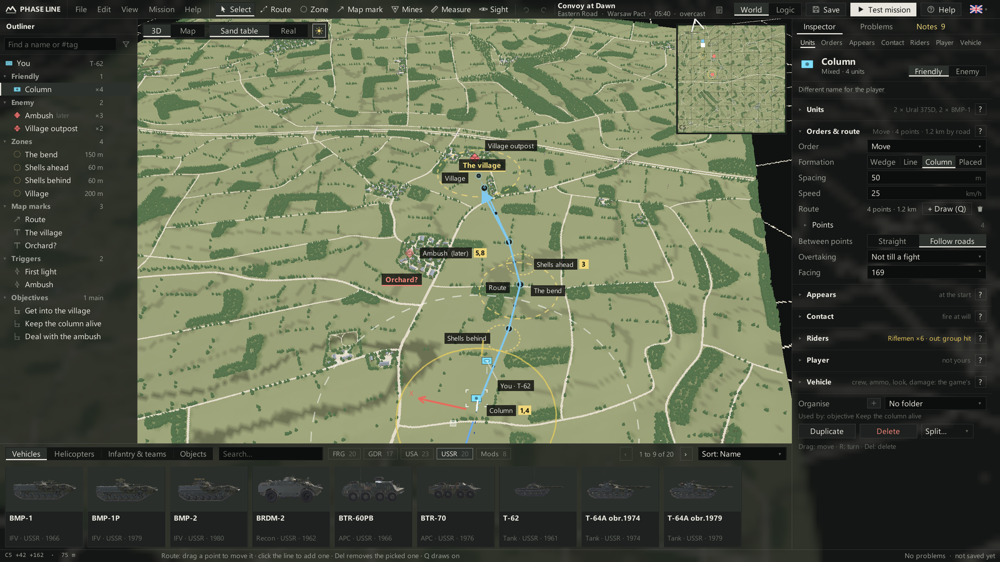
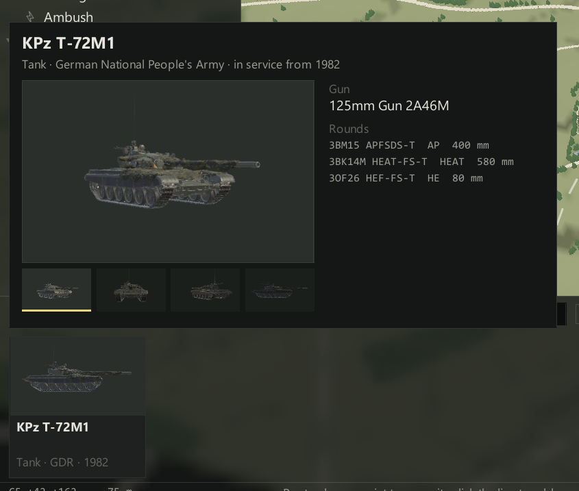
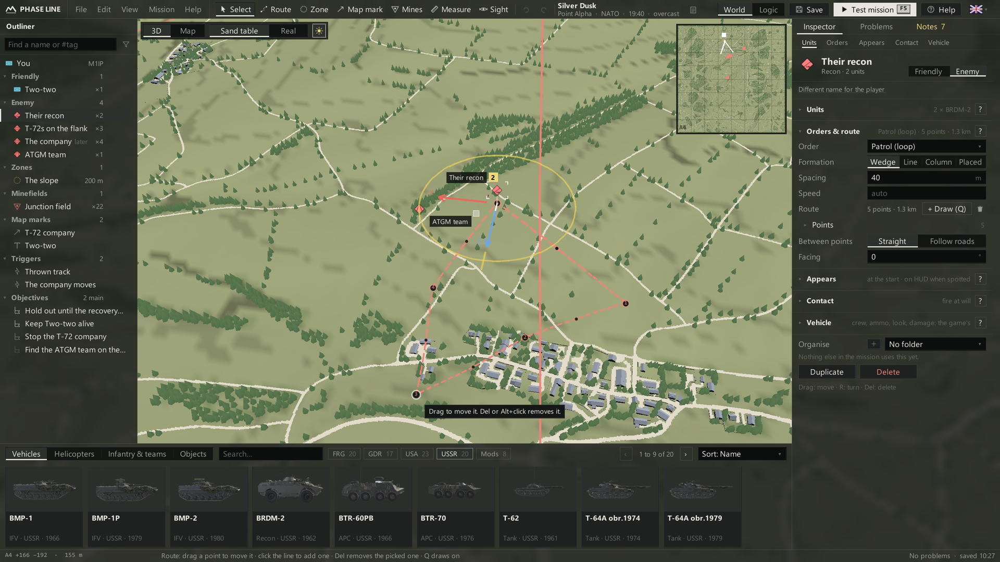
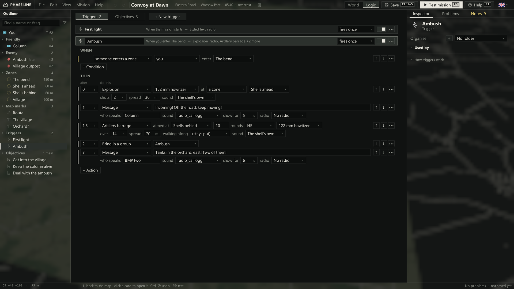

[English](README.md) · **Русский** · [简体中文](README.zh-CN.md)

# Phase Line

**Редактор миссий для *Gunner, HEAT, PC!*, прямо в игре.**

Выбираешь одну из карт игры, ставишь юниты, рисуешь, где они едут, пишешь, что и когда происходит, потом жмёшь F5 и играешь.

**[Скачать](../../releases/latest)** · [Установка](#установка) · [Что внутри](#что-внутри) · [Клавиши](#клавиши) · [FAQ](#faq-и-известные-ограничения)

**[Заходи в неофициальный Discord по моддингу GHPC](https://discord.gg/BW2sgyCht7)**: обновления, WIP, релизы других модов и общение с моддерами и всем сообществом.

---

Миссии в GHPC отличные, но их не так много, и к десятому заходу ты знаешь, где стоит каждый Т-72. Мне хотелось своих: колонна, которую накрывают на повороте дороги, высота, которую надо держать ещё десять минут, ведомый, у которого слетела гусеница в самый неподходящий момент. Писать такое руками в JSON-файле никакого удовольствия, поэтому я встроил редактор в игру.

Всё, что ты ставишь, настоящее. Танки в редакторе — это машины самой игры, а взрывы — снаряды самой игры. F5 сажает тебя в танк, клавиша слева от 1 возвращает в редактор туда, где ты остановился.

## Установка

**Нужно:** *Gunner, HEAT, PC!* сборка 20261014 и MelonLoader 0.7.x.

1. Поставь MelonLoader через [установщик MelonLoader](https://github.com/LavaGang/MelonLoader.Installer). Если он не находит игру, укажи ему `steamapps\common\Gunner HEAT PC\Bin\GHPC.exe`.
2. Запусти игру один раз и закрой.
3. Скачай `PhaseLine.dll` из [Releases](../../releases/latest) и положи в `Bin\Mods`.
4. Запусти игру. **Phase Line** будет в главном меню.

Работает сам по себе. С **Combat Overhaul** он переезжает в меню этого мода и берёт его оформление. С **Task Force** свои миссии можно играть в кооперативе.

Первый раз? **Phase Line > Твоя первая миссия.** Гайд шаг за шагом собирает с тобой небольшую миссию, а в конце ты её играешь. Минут 15. F1 в любом месте редактора открывает справочник.

**Удаление:** удали `Mods\PhaseLine.dll`. Твои миссии остаются в `Bin\UserData\PhaseLine`.

## Что внутри

### Редактор

- **Все юниты, какие есть в игре.** Танки, БМП, грузовики, вертолёты, пехота, расчёты ПТУР, с фотографиями, снятыми в твоей же игре. Наведи на юнит, и увидишь его орудие, снаряды с бронепробиваемостью и год принятия на вооружение. Машины из модов (Fulda Expansion Pack, Pact Increased Lethality) тоже есть в списке.
- **Три вида.** Макет, который легко читать, настоящий вид игры и плоская карта с сеткой.
- **Outliner и Inspector.** Слева папки, теги, поиск, скрытие и блокировка. Справа всё про то, что ты выбрал, в сворачиваемых разделах.
- **Отмена с историей**, копирование и вставка между миссиями, шаблоны.
- **Список «Проблемы»**, который ещё до теста говорит, что сломает миссию.
- **Заметки**, которые прикрепляешь к группам, триггерам и настройкам, для того, кто потом откроет твою миссию.

### Группы и приказы

- «Стоять», «Движение», «Патруль», «Атака», «Охота». Строй, интервалы, скорость.
- **Маршруты можно править потом.** Перетащи точку маршрута, добавь новую посередине, удали лишнюю.
- **Варианты и запасные точки старта**, разыгрываются при каждом запуске, так что враг стоит не там, где в прошлый раз.
- Навык экипажа, точный боекомплект, свой собственный снаряд, окраска и укладка.
- **Повреждения ещё до начала стрельбы.** Любая часть любой машины: ведомый со слетевшей гусеницей, Т-72 с мёртвым тепловизором.
- **Пехота.** Готовые отделения или своё снаряжение каждому бойцу, десант в БТР, который спешивается по твоей команде (или когда по нему попали), группы до 200 человек.
- **Твой взвод.** Ведомые, которые идут за тобой, выбор машины для игрока, пересадка в другой танк, когда твой горит.

### Конвои

Поставь группе **Ехать по дорогам**, и она поедет колонной. Ты кликаешь места, которые важны (старт, развилку, мост), а дорогу между ними миссия достраивает сама.

- Держатся дороги, со всеми поворотами, и держат дистанцию. Задние притормаживают, когда сбиваются в кучу, головная сбавляет ход, когда колонна растянулась.
- **Порядок конвоя**, когда тебя заметили: машины, которые уже в зоне огня, проскакивают её насквозь, остальные встают, не доезжая, расходятся на обе стороны стволами к угрозе, десант спешивается.
- **Грузовики в бою:** грузовики могут ехать дальше, пока сопровождение остаётся и воюет.
- **Обгон:** «Никогда», «Всегда» или «Не до боя».
- Когда колонна отходит, она сдаёт назад по дороге, а не через поле.
- Дороги, которые ты нарисовал сам, тоже считаются.

### Логика

- **Триггеры читаются как предложения.** «Когда игрок въезжает в поворот: снаряды по дороге, вызов по рации, заходит засада.» Время, зоны, потери, задачи, другие триггеры, кодовые сигналы.
- **Подкрепления** грузятся вместе с картой и спрятаны, пока их не вызовет триггер, так что ничего не подтормаживает.
- **Огонь по сценарию.** Одиночные взрывы, артналёты, дым, осветительные ракеты, самолёты или один снаряд точно в ту часть танка, которую ты выбрал.
- **Звук и картинка.** Переговоры по рации, реплики, музыка, картинки, текст печатной машинкой, титры, кадры камеры, замедление.
- **Задачи.** Уничтожить, дойти, удержать, защитить, выжить, разведзадачи, не дать им дойти до места, скрытые бонусные.

### На карте

- Зоны, метки на карте и знаки НАТО, которые игрок видит у себя на карте.
- Дома, стены, окопы и огневые позиции.
- Минные поля, которые рисуешь сам, со знаками, если они твои.
- Дороги, мосты, леса и поляны.

### Zeus

Нажми **\\** в запущенной миссии, и ты над боем со свободной камерой. Выбирай юниты, правым кликом показывай, куда им ехать или кого бить, спавни взвод за гребнем, сбрасывай ОФ, дым, мины или СВУ, ставь паузу, прыгай в любой танк. Если хочешь по-честному, есть очки, которые надо тратить. Когда бой получился хороший, сохрани его как новую миссию.

В тестовом запуске **Правка миссии** кладёт панели редактора поверх боя. Что меняешь, сохраняется и срабатывает сразу.

Игроки получают Zeus, только если это разрешено в миссии. По умолчанию он твой, в тестовых запусках.

### Брифинг, дебрифинг, отчёт о бое

- Брифинг с твоим текстом, картинками и музыкой и оперативная карта с твоими стрелками и районами задач.
- Настоящая дата с настоящими солнцем и луной, погода и туман.
- Огневая поддержка для игрока на родном экране карты: артиллерия, дым, осветительные и авиаудары на картах, где есть самолёты.
- После миссии: как всё прошло, потом отчёт о бое, где видно, кто куда ехал и кто кого подбил.

### Кампании

Миссии одна за другой, с ветками на победу и поражение. Четыре вида: простая цепочка, потери, которые остаются, экипаж с именами, который набирается опыта (или которого меняют), или целая рота, которую между миссиями чинишь и пополняешь.

### Обмен миссиями

**Поделиться** пакует сколько угодно миссий в один файл `.ghpack` вместе с их картинками и звуками. Тому, кто его импортирует, говорят, какие моды нужны, и он может выбрать замену для любой машины, которой у него нет.

Включи **Закрыто: только играть**, и люди смогут играть твою миссию, но не смогут открыть её в редакторе.

### Примеры миссий

Играй в них или открой копию и разбери по кусочкам. В каждой есть заметки о том, как она собрана.

| | |
|---|---|
| **Convoy at Dawn** | Веди колонну снабжения по Восточной дороге. Кто-то всю ночь следил за этой дорогой. |
| **Human Wave** | Четыре M113 на высоте. Двести человек лезут вверх по склону. |
| **Silver Dusk** | У твоего ведомого слетела гусеница у Point Alpha. Ремонтно-эвакуационная машина в десяти минутах. |

И пример кампании, **Three Days on the Border**.

### Как разобраться

- **Обзор:** по одной короткой карточке на каждую часть редактора.
- **Твоя первая миссия** и **Миссия побольше:** гайды, которые собирают миссию вместе с тобой и ждут каждого шага.
- Короткие гайды: Browser, Inspector, Логика, Настройки миссии, Минные поля и Тест.
- **Справочник** на F1, со страницей на каждую часть. На английском, русском и китайском.
- Сам редактор на английском, польском, немецком, русском и китайском.

## Клавиши

В редакторе:

| Клавиша | |
|---|---|
| F1 | Справочник |
| F2 | Настройки миссии |
| F5 | Тест миссии |
| Tab | Плоская карта / 3D |
| T | Макет / реальный вид |
| L | Логика |
| V | Выбор |
| Q | Нарисовать маршрут выбранной группе |
| Z | Нарисовать зону |
| R / Shift+R | Повернуть выбранное на 15° |
| M | Линейка |
| K | Линия видимости |
| F | Подлететь к выбранному |
| N | Ночная подсветка |
| Правая кнопка мыши + W A S D | Осмотр и полёт (Space вверх, C вниз, Shift быстрее) |
| Ctrl+S / Ctrl+O | Сохранить / открыть |
| Ctrl+Z / Ctrl+Y | Отменить / повторить |
| Ctrl+C / Ctrl+V / Ctrl+D | Копировать / вставить / дублировать |
| Ctrl+F | Поиск в Outliner |
| Del | Удалить |

В миссии:

| Клавиша | |
|---|---|
| ` (слева от 1) | Назад в редактор из тестового запуска |
| \\ | Zeus, если миссия это разрешает |
| Enter | К дебрифингу, когда миссия окончена |
| Alt+1 … Alt+4 | Кодовые сигналы |

Любую клавишу редактора можно переназначить в его настройках, раздел «Клавиши и мышь». Клавиша, занятая дважды, горит красным.

## Где лежат твои файлы

Всё лежит в `Bin\UserData\PhaseLine`:

| | |
|---|---|
| `Missions\` | По папке на миссию, её картинки и звуки в `media\`. |
| `Samples\` | Примеры миссий. Возвращаются при каждом обновлении, так что меняй копии, а не их. |
| `Packs\` | Файлы `.ghpack`, которые ты сделал или хочешь импортировать. |
| `photos\` | Фото техники, снятые один раз на твоём ПК. |

Удалённая миссия становится файлом `.deleted` рядом с остальными, так что её можно вернуть руками.

## С другими модами

- **Combat Overhaul:** Phase Line сидит в его меню и берёт его оформление. Мины видны в камере попаданий и в Hit Log.
- **Task Force:** миссия хоста отправляется всем в лобби, триггеры хоста работают для всех, а у хоста может быть Zeus.
- **Моды на технику:** их машины есть в списке, а миссия помнит, из какого мода взята машина.

## FAQ и известные ограничения

**Нужны Combat Overhaul или Task Force?** Нет. Phase Line работает сам по себе.

**Можно потом поменять карту или сторону?** Нет. Миссия сделана на одной карте и за одну сторону. Юниты, маршруты и зоны привязаны к этой карте.

**Моя колонна едет напрямик через поле.** Поставь «Между точками» на «Ехать по дорогам». На «Напрямую» машинами управляет родной ИИ игры, а он не знает дорог, которые ты нарисовал.

**Может кто-то открыть мою закрытую миссию?** В редакторе нет. Но это замок, а не сейф: человек с декомпилятором и свободным вечером всё равно залезет.

**Исходники доступны?** Нет. У Phase Line закрытый код, в релизах только DLL.

Полезно знать:

- Zeus не умеет спавнить вертолёты.
- То, что заспавнил Zeus, есть только в этом запуске, если не сохранить бой как миссию.
- Подкрепления появляются там, где стоят. Ставь их туда, где игрок не видит.
- Справочник на английском, русском и китайском. На польском и немецком он показывается на английском.
- Обновление игры может сломать часть мода, пока мод не обновится.

## Баги, идеи

Открой issue и приложи `Bin\MelonLoader\Latest.log`. Если дело в миссии, запакуй в zip её папку из `UserData\PhaseLine\Missions` и тоже приложи.

## Благодарности

- Radian Simulations, за игру. Phase Line сделан не ими и ими не одобрен.
- Всем, кто с ноября тестировал сборки, ломал свои миссии и присылал логи.

## Лицензия

Все права защищены. Скачивать и играть можно бесплатно, только не перезаливай его в другие места.

*Gunner, HEAT, PC!* и всё, что в ней есть, принадлежит Radian Simulations.
