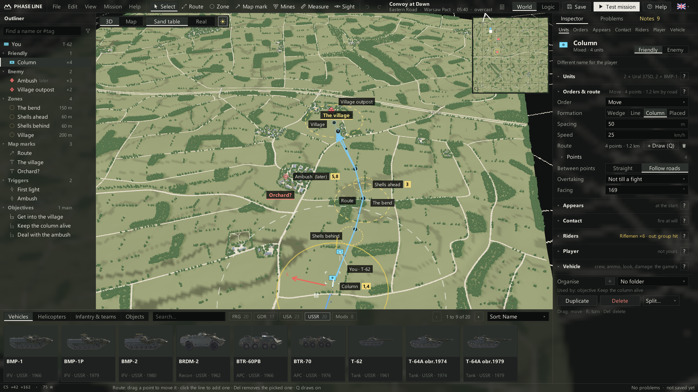
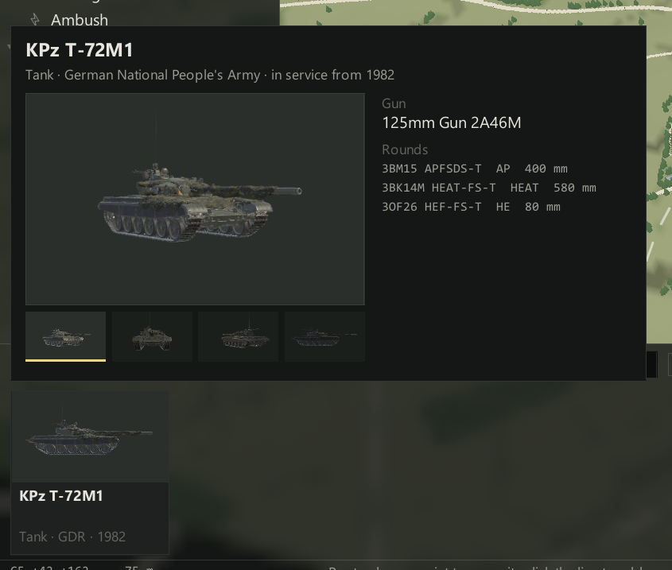
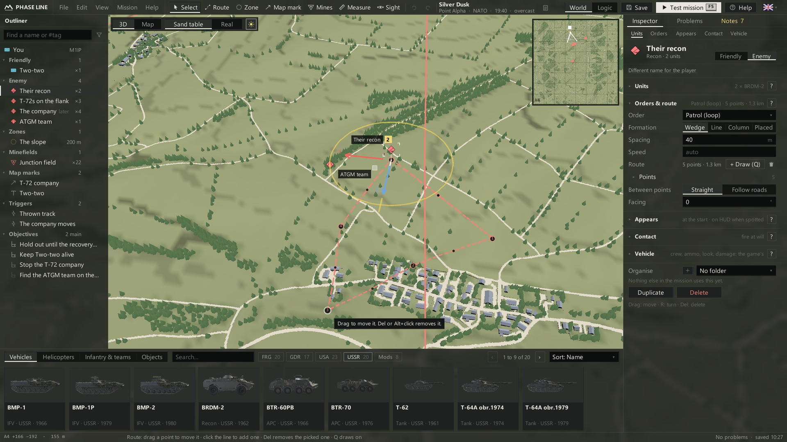
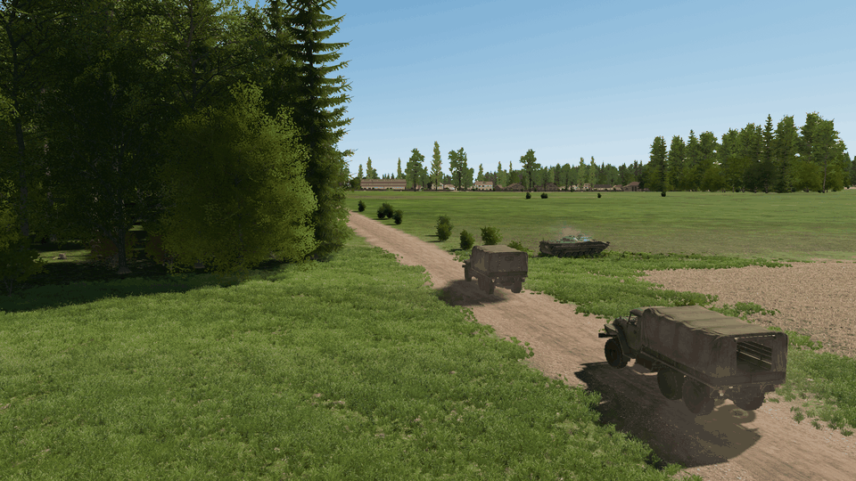
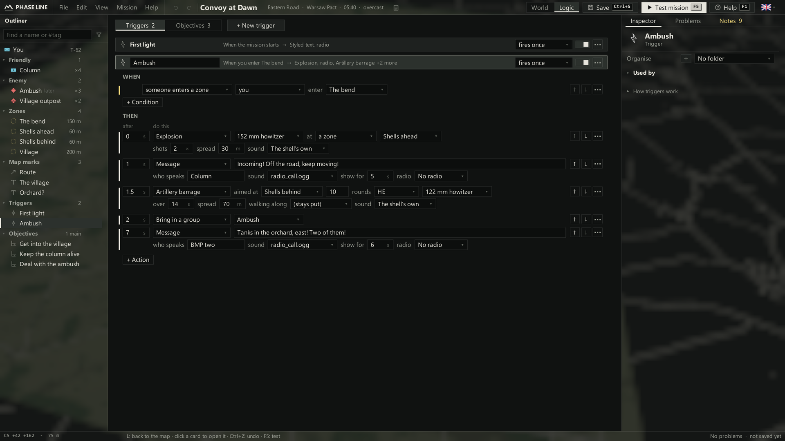

[English](README.md) · [Русский](README.ru.md) · **简体中文**

# Phase Line

**任务编辑器，适用于 *Gunner, HEAT, PC!*，就在游戏里面。**

挑一张游戏地图，摆上单位，画出它们走的路线，写好什么时候发生什么，然后按 F5 开玩。

**[下载](../../releases/latest)** · [安装](#安装) · [模组内容](#模组内容) · [按键](#按键) · [常见问题](#常见问题与已知限制)

**[加入非官方 GHPC 模组 Discord](https://discord.gg/BW2sgyCht7)**：更新、开发中的内容、其他模组发布，还能和模组作者以及整个社区聊天。

---

GHPC 的任务很棒，但就那么几个，打到第十遍你已经知道每辆 T-72 停在哪。我想要自己的任务：一支在公路拐弯处挨打的车队，一个还得再守十分钟的山头，一个在最要命的时候掉了履带的僚车。在 JSON 文件里手写这些一点都不好玩，所以我把编辑器直接做进了游戏。

你摆的都是真东西。编辑器里的坦克就是游戏自己的载具，爆炸就是游戏自己的炮弹。按 F5 你就坐进坦克，按 1 左边那个键回到编辑器，接着刚才的地方继续。

## 安装

**需要：** *Gunner, HEAT, PC!* 版本 20261014 和 MelonLoader 0.7.x。

1. 用 [MelonLoader 安装器](https://github.com/LavaGang/MelonLoader.Installer) 安装 MelonLoader。如果它找不到游戏，就手动指向 `steamapps\common\Gunner HEAT PC\Bin\GHPC.exe`。
2. 启动一次游戏，然后关掉。
3. 从 [Releases](../../releases/latest) 下载 `PhaseLine.dll`，放进 `Bin\Mods`。
4. 启动游戏。主菜单里会有 **Phase Line**。

它可以单独用。装了 **Combat Overhaul** 的话，它会搬进那个模组的菜单，用它的外观。装了 **Task Force** 的话，你的任务可以联机合作玩。

第一次用？**Phase Line > 你的第一个任务。** 它一步一步带你做一个小任务，最后让你自己玩一遍。大概 15 分钟。在编辑器里任何地方按 F1 都能打开手册。

**卸载：** 删掉 `Mods\PhaseLine.dll`。你的任务会留在 `Bin\UserData\PhaseLine`。

## 模组内容

### 编辑器

- **游戏里的每一种单位。** 坦克、步兵战车、卡车、直升机、步兵、反坦克导弹小组，配的照片都是在你自己的游戏里拍的。鼠标悬停就能看到它的主炮、弹药和穿深，以及服役年份。模组里的载具（Fulda Expansion Pack、Pact Increased Lethality）也在列表里。
- **三种视图。** 好认的沙盘、游戏的真实画面，以及带网格的平面地图。
- **大纲和属性。** 左边是文件夹、标签、查找、隐藏和锁定。右边是你选中的东西的全部信息，分成能折叠的小节。
- **带历史记录的撤销**，在任务之间复制粘贴，模板。
- **问题列表**，在你测试之前就告诉你什么会让任务出毛病。
- **笔记**，可以钉在编组、触发器和设置上，留给以后打开你任务的人看。

### 编组与命令

- 坚守、移动、巡逻、进攻、搜索歼敌。队形、间距、速度。
- **路线画完还能改。** 拖动航路点，在中间加一个，删掉一个。
- **变体和备用出生点**，每次开玩都重新随机，敌人不会还待在上次的位置。
- 乘员技能、弹架里具体装哪些弹、你自己做的弹种、涂装和外挂物品。
- **开打之前就带伤。** 任何载具的任何部件：掉了履带的僚车，热像仪坏掉的 T-72。
- **步兵。** 用预设班组，或者给每个人单独配装备；装甲运兵车里的搭载步兵在你下令时（或者挨打时）下车；一个编组最多 200 人。
- **你的排。** 跟着你走的僚车，玩家可以挑载具，自己的车着火了就换到另一辆坦克上。

### 车队

把编组设成 **沿道路**，它就会像纵队一样开。你只要点关键的地方（起点、路口、桥），中间的路任务会自己补上。

- 它们沿着公路走，弯道也跟得住，还能保持车距。后面的车挤在一起时会松油门，纵队拉得太长时头车会减速。
- 发现你之后执行 **车队纪律**：已经在伏击区里的车直接冲过去，其余的车在外面停下，往两边散开，炮口对着威胁，搭载步兵下车。
- **交战中的卡车：** 护卫留下来打，卡车可以继续往前开。
- **超车：** 从不、随时，或者交战前不超。
- 纵队后撤时会沿着公路倒车，而不是从田里穿过去。
- 你自己画的路也算数。

### 逻辑

- **读起来像句子的触发器。** “玩家进入弯道时：炮弹落在路上，电台呼叫，伏兵杀出。”时间、区域、损失、目标、其他触发器、行动口令。
- **增援** 跟地图一起加载，在触发器调它们出来之前一直藏着，所以不会卡顿。
- **脚本火力。** 单次爆炸、弹幕、烟幕、照明弹、喷气机，或者一发炮弹精确打在你选定的坦克部位上。
- **声音和画面。** 电台呼叫、语音台词、音乐、图片、打字机文字、标题卡、镜头画面、慢动作。
- **目标。** 摧毁、到达、坚守、保护、生存、侦察类目标、阻止他们到达某地、隐藏的额外目标。

### 地图上的东西

- 区域、地图标记和北约符号，玩家能在自己的地图上看到。
- 房子、墙、战壕和射击阵地。
- 自己画的雷区，是你方布的就带警示牌。
- 道路、桥、树林和林间空地。

### 宙斯

任务进行中按 **\\**，你就用自由镜头悬在战场上空。选中单位，右键点它们要去的地方或者要打的目标，在山脊后面刷出一个排，投下高爆弹、烟幕、地雷或简易爆炸装置，暂停，跳进任何一辆坦克。想打得公平的话还有点数可以花。打得精彩了，就把它存成一个新任务。

测试运行时，**编辑任务** 会把编辑器的面板叠在战斗画面上。你改的东西会保存，并且马上生效。

只有任务允许时，玩家才能用宙斯。默认是给你在测试运行里用的。

### 简报、任务总结、战斗报告

- 简报里有你写的字、图片和音乐，还有一张作战地图，上面是你画的箭头和目标区域。
- 真实日期，带真实的太阳和月亮，还有天气和雾。
- 玩家可以在游戏自己的地图界面上呼叫火力支援：火炮、烟幕、照明弹，有喷气机的地图上还有空袭。
- 任务结束后：先看打得怎么样，再看战斗报告，里面有每个人开过的路线，谁干掉了谁。

### 战役

任务一个接一个，胜负各走不同分支。四种：普通的线性串联，损失会保留，有名字的乘员会成长（或者被换掉），或者一整个连队，每场任务之间你要修车、补员。

### 分享

**分享** 可以把任意多个任务连同图片和声音打包成一个 `.ghpack` 文件。导入的人会被告知需要哪些模组，没有的载具可以挑一个替代。

打开 **锁定：仅可游玩**，别人就只能玩你的任务，不能在编辑器里打开它。

### 示例任务

直接玩，或者打开一份副本拆开来看。每个任务里都有笔记，讲它是怎么搭的。

| | |
|---|---|
| **Convoy at Dawn** | 带一支补给车队走东部公路。有人盯了这条路一整夜。 |
| **Human Wave** | 山头上四辆 M113。两百个人正往坡上冲。 |
| **Silver Dusk** | 你的僚车在阿尔法观察点掉了履带。抢修车还要十分钟才到。 |

还有一个示例战役，**Three Days on the Border**。

### 怎么上手

- **导览：** 编辑器的每个部分一张短卡片。
- **你的第一个任务** 和 **更大的任务：** 带你一起做任务的引导，每一步都会等你做完。
- 短引导：浏览器、属性面板、逻辑、任务设置、雷区和测试。
- 按 F1 打开 **手册**，每个部分都有一页。有英文、俄文和中文。
- 编辑器本身有英文、波兰文、德文、俄文和中文。

## 按键

编辑器里：

| 按键 | |
|---|---|
| F1 | 手册 |
| F2 | 任务设置 |
| F5 | 测试任务 |
| Tab | 平面地图 / 3D |
| T | 沙盘 / 真实 |
| L | 逻辑 |
| V | 选择 |
| Q | 给选中的编组画路线 |
| Z | 画区域 |
| R / Shift+R | 把选中对象转 15° |
| M | 测量 |
| K | 视线 |
| F | 飞到选中对象 |
| N | 夜间照明 |
| 鼠标右键 + W A S D | 环顾和飞行（Space 上升，C 下降，Shift 加速） |
| Ctrl+S / Ctrl+O | 保存 / 打开 |
| Ctrl+Z / Ctrl+Y | 撤销 / 重做 |
| Ctrl+C / Ctrl+V / Ctrl+D | 拷贝 / 粘贴 / 复制 |
| Ctrl+F | 在大纲里查找 |
| Del | 删除 |

任务里：

| 按键 | |
|---|---|
| `（1 左边那个键） | 从测试运行返回编辑器 |
| \\ | 宙斯，任务允许时 |
| Enter | 任务结束后前往任务总结 |
| Alt+1 到 Alt+4 | 行动口令 |

编辑器的每个按键都能在编辑器设置的“按键与鼠标”里改。一个键被用了两次会显示成红色。

## 你的文件在哪

全都在 `Bin\UserData\PhaseLine`：

| | |
|---|---|
| `Missions\` | 每个任务一个文件夹，图片和声音在 `media\` 里。 |
| `Samples\` | 示例任务。每次更新都会放回去，所以要改就改副本，别改这些。 |
| `Packs\` | 你做的或者想导入的 `.ghpack` 文件。 |
| `photos\` | 载具照片，在你电脑上拍一次就行。 |

删掉的任务会变成旁边的一个 `.deleted` 文件，想找回来可以手动改回去。

## 与其他模组一起用

- **Combat Overhaul：** Phase Line 待在它的菜单里，用它的外观。地雷会显示在命中镜头和命中记录里。
- **Task Force：** 主机的任务会发给大厅里的每个人，主机的触发器对所有人生效，主机可以用宙斯。
- **载具模组：** 它们的载具会出现在列表里，任务会记住每辆载具来自哪个模组。

## 常见问题与已知限制

**我需要 Combat Overhaul 或 Task Force 吗？** 不需要。Phase Line 可以单独运行。

**之后还能换地图或阵营吗？** 不能。一个任务只对应一张地图和一个阵营。单位、路线和区域都属于那张地图。

**我的纵队直接从田里穿过去了。** 把“点之间”设成“沿道路”。设成“直线”时开车的是游戏自己的 AI，它不认识你画的路。

**别人能打开我锁定的任务吗？** 在编辑器里不能。但这是把锁，不是保险柜：有反编译器又有一下午空闲的人还是能进去。

**有源代码吗？** 没有。Phase Line 不开源，只发布 DLL。

须知：

- 宙斯不能生成直升机。
- 宙斯生成的东西只在这一局有效，除非你把这场战斗存成任务。
- 增援会在它们摆放的位置出现。把它们放在玩家看不到的地方。
- 手册有英文、俄文和中文。在波兰语和德语下显示英文。
- 游戏更新后，模组没跟着更新之前，部分功能可能会坏。

## Bug 与建议

请开 issue，并附上 `Bin\MelonLoader\Latest.log`。如果是某个任务的问题，把 `UserData\PhaseLine\Missions` 里那个任务的文件夹打成 zip 一起附上。

## 致谢

- Radian Simulations，感谢他们做了这款游戏。Phase Line 不是他们做的，也没有得到他们的认可。
- 所有从十一月起测试各个版本、把自己的任务搞坏还发来日志的人。

## 许可

保留所有权利。可以免费下载和游玩，请不要转载到其他地方。

*Gunner, HEAT, PC!* 及其全部内容归 Radian Simulations 所有。
