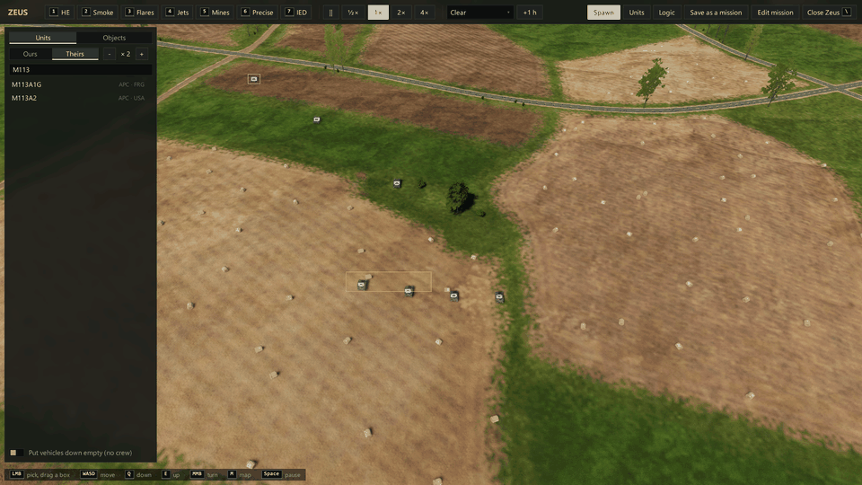

**1.0.0 - 纵队**

东部公路上的一支补给纵队，车距保持住，护卫在前。这是你十分钟前摆下的。现在去伏击它吧。

第一个公开版本。测试者从十一月初就开始用 0.1.x 版本了。这里是 0.1.6 之后的全部内容。

## 新内容

* **车队。** 设成“沿道路”的编组会像真正的纵队一样开：沿着公路过每一个弯，保持车距，头车会等队尾。你自己画的路也一样。
* **车队纪律。** 纵队发现你之后：已经在伏击区里的车直接冲过去，其余的往两边散开，炮口对着威胁，搭载步兵下车。护卫交战时卡车可以继续开。
* **宙斯。** 在进行中的战斗上空按 \：下命令、生成单位、投下高爆弹、烟幕、地雷或简易爆炸装置、暂停、跳进任何一辆坦克。把这场战斗存成新任务。

  

* 测试运行中的 **编辑任务**。编辑器的面板叠在战斗画面上。改一个编组或触发器，会保存并马上生效。
* **路线画完还能改。** 拖动航路点，在中间加一个，删掉一个。
* **战役。** 任务一个接一个，胜负各走不同分支。损失会保留、乘员有名字和技能，或者要保住一整个连队。
* **步兵随你配。** 用预设班组，或者给每个人单独配装备。搭载步兵挨打时会下车。
* **发现你时：** 继续执行命令、停下战斗、冲向敌人、寻找掩护、车队纪律。还有打完之后他们做什么。
* 自己画的 **雷区**，带警示牌。战壕和射击阵地。道路、桥、树林和林间空地。

  

* 任务结束后的 **战斗报告**：所有人的行进轨迹，每个阵亡的位置画一个叉，谁干掉了谁。

  

* **打一发。** 一发真实的炮弹，精确打在你选定的坦克部位上。另外镜头画面和慢动作也可以作为触发器动作。
* **属性面板整理过了。** 小节能折叠并记住状态，每节有一行摘要，“?”会打开手册里对应的那一页。
* **触发器读起来像句子**，动作列表也分了组，不再是一列 44 行。
* **引导。** 导览、你的第一个任务、更大的任务，以及编辑器每个部分的短引导。
* F1 **手册**，现在也有俄文和中文。
* **大纲。** 文件夹、标签、查找、隐藏、锁定。
* 带历史记录的撤销，在任务之间复制粘贴，模板。
* 移动和旋转手柄、框选、测量、视线、武器与视野范围圈。
* 玩家地图上的地图标记和北约符号。
* 按键显示成键帽样式。编辑器的每个按键都可以改。
* 在英文、波兰文和中文之外，新增俄文和德文。
* 配合 Task Force：联机合作玩你的任务。主机的任务会发给所有人。

## 问题修复

* 保存被打断时，任务可能会从列表里消失。
* 保存失败后接着测试或切换，你的修改会丢失。
* 所有任务都自动保存到同一个文件里。
* Phase Line 任务的雾会残留到游戏自带的任务里。
* 点“再玩一次”或“下一个任务”之后火力支援没了。
* “再玩一次”开始的是上一局结束时的样子，而不是你做好的样子。
* “返回任务列表”可能把你留在一个卡住的任务里。
* 看不见的桥墙留在地图上挡住你。
* 离开后战壕的坑还留在地图上。
* 选中一个编组可能会删掉它的搭载步兵。
* “传送编组”动作只移动了模型。
* 同一时刻触发的触发器动作按相反顺序执行。
* “坚守区域”目标的计时在挨打时走得太快。
* 在过场时打开宙斯会黑屏。
* “另存为任务”会丢掉图片和声音。
* 导入窗口只显示 16 个包。
* 编辑器每帧的工作量少了很多：大纲、任务列表和浏览器在大任务里不再卡顿。

## 即将推出

* **季节。** 秋天、冬天，在雪里打仗。很快就来。
* 用真实地点做的地图，还有高速公路。

**安装：** MelonLoader 0.7.x，把 `PhaseLine.dll` 放进 `Bin\Mods`。可以单独用，也可以和 Combat Overhaul 2.0、Task Force 1.0 一起用。

**从测试版升级：** 用新的 DLL 覆盖旧的。你的任务会保留。

Bug：请开 issue，附上 `Bin\MelonLoader\Latest.log`，如果是某个任务的问题，再把任务文件夹打成 zip 附上。
